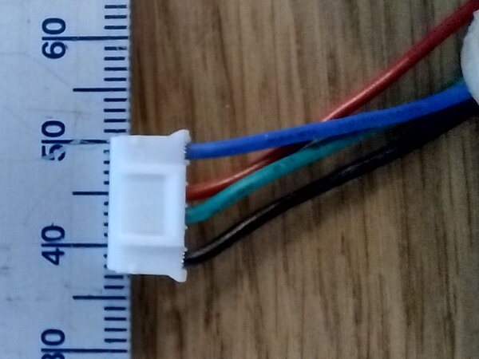
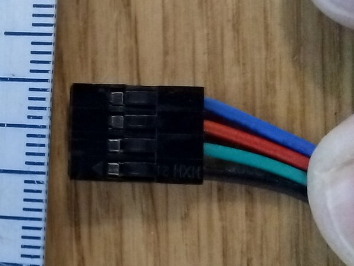
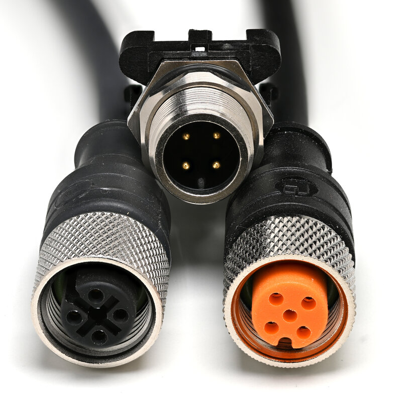
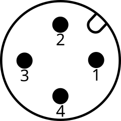
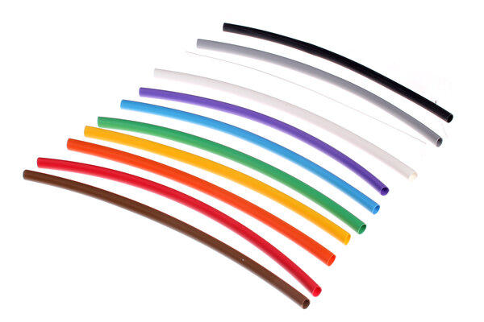
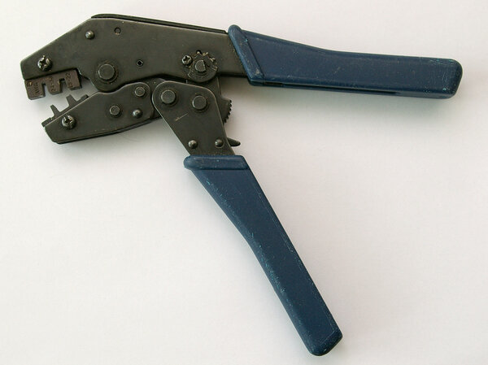

# The Electronics Box

## Table of Contents <!-- omit in toc -->

- [Introduction](#introduction)
- [The Box](#the-box)
  - [The Inner Panels](#the-inner-panels)
- [The Connectors of the Motors](#the-connectors-of-the-motors)
- [The Connector on the Panel](#the-connector-on-the-panel)
  - [M12, A-coded, 4-Pin](#m12-a-coded-4-pin)
  - [Alternatives](#alternatives)
- [Wiring](#wiring)
  - [The Pins](#the-pins)
  - [Inside the Box](#inside-the-box)
  - [The Cable](#the-cable)
  - [The Motor End](#the-motor-end)
- [The USB Ports](#the-usb-ports)
  - [The Controllers](#the-controllers)
  - [On the Panel](#on-the-panel)
  - [Which Port for Which Device](#which-port-for-which-device)
- [The Network Port](#the-network-port)
- [Safety](#safety)
- [Shopping List](#shopping-list)

## Introduction

This document explains how to build the electronics box of the rig: the enclosure that holds all of its electronics, among them the Teensy and the [PiBot board](../../modules/stepit-motors/docs/hardware/PiBotMDRB.pdf) with its TMC2208 drivers. It is the physical box, not the Docker container that runs the software.

For now it covers the connectors of the five stepper motors on the panel of the box, and the USB and network ports of the Raspberry Pi 5. It follows one idea: **use a standard industrial connector on the panel, the same one for every motor, with the sockets on the box**.

The suggestions follow the European standards, and the parts are easy to find in Poland.

## The Box

The box is a [Hammond `1457T2201`](https://www.tme.eu/pl/details/hm-1457t2201/obudowy-z-panelem/hammond/1457t2201/): an extruded aluminium enclosure of 165 mm × 220 mm × 55 mm, IP65, closed by two removable end panels. The connectors of the motors go on one of these panels.

The panel is 165 mm wide and 55 mm high on the outside: five M12 sockets about 25 mm apart, about 120 mm with their nuts, fit in one row across it.

### The Inner Panels

The boards inside the box are mounted on inner panels of FR4, the glass-fibre material of circuit boards, 1.5 mm thick: [Solder Peak `LAM160X233E1.5`](https://www.tme.eu/pl/details/lam160x233e1.5/laminaty-jednostronne/solder-peak/), 160 mm × 233 mm. They slide into the slots inside the extrusion of the box.

- **Cut them to length.** A panel is 233 mm long and the box 220 mm. Take the length and the width of the slots from Hammond's datasheet of the `1457T2201`, and leave room for the end panels and the connectors behind them.
- **One side is copper.** The laminate is single-sided: its copper conducts, and must never touch the pins under a board. Mount the boards on spacers on the bare side, or connect the copper to the ground of the box and use it as a shield.

## The Connectors of the Motors

Each motor today has one cable with two different connectors:

| End | Connector | Pitch | Housing |
|---|---|---|---|
| Motor | JST PH, white | 2.0 mm | 6 positions, 4 wires in positions 1, 3, 4 and 6, as on most NEMA 17 motors |
| Board | Dupont, black | 2.54 mm | 4 positions, on the pin header of the PiBot board |

<table>
  <tr>
    <td></td>
    <td></td>
  </tr>
  <tr>
    <td>JST PH, into the motor</td>
    <td>Dupont, onto the board</td>
  </tr>
</table>

The wires run straight through, in the same order at both ends: blue, red, green, black.

Neither connector is made for a panel. Both are board-to-wire connectors with a weak latch, no strain relief and no way to mount them on a panel.

The load is small: a TMC2208 drives at most about 1.2 A RMS per coil, at 12 V to 24 V DC. Any connector rated 2 A or more on 4 pins is enough.

## The Connector on the Panel

### M12, A-coded, 4-Pin

The recommended connector is the **M12, A-coded, 4-pin**, standardised in IEC 61076-2-101. It is the European industrial standard for sensors and small motors, used e.g. by Nanotec, Festo and Siemens.

- **Ratings**: 4 A and 250 V per contact, IP67, with a screw lock. It is keyed, so it cannot go in rotated.
- **On the panel**: a female socket, with flying leads ("z przewodami", 0.5 m) or solder cups. It mounts in a PG9 or M16 hole: check the datasheet of the socket for the exact size.
- **Cables**: ready-made M12 4-pin male cables with one open end are cheap, 1 m, 2 m or 5 m long. Only the JST PH at the motor end has to be fitted by hand.



Two A-coded 4-pin M12 plugs and a socket for a panel, here with pins. For the box, buy the female socket, with holes like the plugs in the picture, and male plugs on the cables. Photo: [Phiarc](https://commons.wikimedia.org/wiki/File:M12_plugs_with_M12_bulkhead_socket.jpg), [CC BY-SA 4.0](https://creativecommons.org/licenses/by-sa/4.0/).

The key, the notch on the edge, lets a plug go in one way only. The pins are numbered 1 to 4 around the face, so 1 and 2 are neighbours, and so are 3 and 4:



The face of a socket shows the numbers mirrored: check them on the datasheet, or on the insert, where most connectors have them printed. Diagram: [Malvineous](https://commons.wikimedia.org/wiki/File:IEC_61076_M12_A-coding_4-pin_connector_diagram.svg), [CC BY-SA 4.0](https://creativecommons.org/licenses/by-sa/4.0/).

Five M12 sockets need about 25 mm between their centres.

### Alternatives

| Connector | When to use it | Note |
|---|---|---|
| M8, 4-pin | The panel is too small for five M12 | Same family of standards, about 3 A to 4 A, smaller hole. |
| GX16-4, "aviation" connector | The cheapest option, common on Allegro and in hobby CNC machines | Not a standard, and the quality varies. It is often sold for 250 V: never use it for anything else in the same box, e.g. mains or a sensor, or a motor can be plugged into the wrong socket. |

## Wiring

Each motor goes from the board to the motor through the panel:

<!-- The source is ../diagrams/motor-wiring.mmd: change it, then run bin/render-diagrams.sh. -->
<p align="center"></p>

**The socket goes on the box, the plug on the cable.** The side that carries the power must never have exposed pins.

### The Pins

Each coil goes on two neighbouring pins, in the same order on all five sockets:

| Motor wire | Dupont position | M12 pin | Wire of a standard M12 cable |
|---|---|---|---|
| blue | 1 | 1 | brown |
| red | 2 | 2 | white |
| green | 3 | 3 | blue |
| black | 4 | 4 | black |

Ready-made M12 cables follow the colours of EN 60947-5-2, in the last column. Their blue wire is on pin 3, not where the motor's blue wire goes: wire by pin number, never by colour.

Check the pairs with a multimeter at the motor's plug before wiring: one coil reads about 1 Ω to 4 Ω, and there is no continuity between the two coils. On most 17HS motors the pairs are red and blue, and green and black, which matches the table. A coil wired the other way round only reverses the motor, which you can fix in software or by swapping its two wires.

### Inside the Box

Crimp female Mini-PV contacts, the original Dupont, on the socket's leads with the Engineer PA-09, and push them into a 4-position housing. Fix each housing to the pin header with a dot of hot glue or a cable tie: Dupont pins work loose with vibration.

Label the sockets `M1` to `M5`, after the joints of the robot.

### The Cable

The cable is a ready-made M12 cable, 4 wires, with an open end, in PUR, which bends well on an axis that moves. It has no shield, which is enough at 2 m with the TMC2208. If the noise of the drivers ever disturbs the camera or the USB lines, put a clip-on ferrite on each cable next to the box.

A shielded cable helps only with a shielded panel socket, connected to the ground of the box. Connect the shield **at the box end only**, and leave it unconnected at the motor.

### The Motor End

Crimp JST PH contacts on the open end of the cable with the Engineer PA-09, and push them into a PHR-6 housing, in positions 1, 3, 4 and 6, as in the motor's original cable. Take the contacts for 22 AWG to 26 AWG, `SPH-002T-P0.5L`: the common `SPH-002T-P0.5S` takes only 24 AWG to 30 AWG. JST's own crimping tool is not needed.

Strip about 1.5 mm to 2 mm of each wire. Slide a piece of heat-shrink tubing, about 3 cm, over the end of the jacket and the start of the wires, and shrink it with a heat gun: it holds the four wires together, so that bending the cable does not pull on the contacts.

## The USB Ports

The Raspberry Pi 5 has four USB-A ports. Two connect it to the controllers inside the box, and two are brought out to the panel for the camera and the gamepad.

### The Controllers

The controllers are connected by short USB 2.0 cables with straight plugs, 0.3 m long:

| Controller | Its port | Cable |
|---|---|---|
| Teensy, of StepIt Motors | micro-USB | USB-A to micro-USB, Logilink `CU0143` |
| Arduino Nano R4, of StepIt Freezer | USB-C | USB-A to USB-C, Logilink `CU0139` |

### On the Panel

The camera and the gamepad plug into two Neutrik `NAUSB-W-B` on the panel. Each is a feedthrough, not a connector with wires: a USB-A socket outside the box, a USB-B socket inside, and a cable plugged into each side.

```
 outside the box  │ panel │  inside the box
                  │       │
 camera ── cable ─┤A    B├── cable (B ... A) ── Raspberry Pi 5
 (mini-B ... A)   │ NAUSB │   bq-cable CAB-USB2AB/0.5-BK
```

- **Mount it with the A side outward.** The insert is reversible: the A or the B socket can face out.
- **The camera and the gamepad use their own cables** on the outside: the camera's goes from USB-A to its mini-B.
- **Inside, a straight USB-A to USB-B cable**, 0.5 m, goes from the back of the feedthrough to the Pi. The shortest one at TME is 0.5 m: fold the extra length into a loose loop held by a cable tie, with no bend tighter than about 2 cm to 3 cm, and keep it away from the wires of the motors.
- **Leave about 6 cm free behind each feedthrough**: the straight B plug sticks out about 3 cm, and the cable needs as much again to curve.
- **The hole** is Neutrik's D-size cutout, a round hole of about 24 mm and two M3 screws: take the drawing from Neutrik's datasheet. The flange is about 26 mm × 31 mm, so it fits on the 55 mm high panel.

The feedthrough is USB 2.0, as are the Canon EOS 5D Mark II and the gamepad. A USB 3 camera would need the `NAUSB3-B` instead, which is USB-A on both sides, with a USB 3 A-to-A cable inside.

### Which Port for Which Device

The Pi 5 has two blue USB 3.0 ports and two black USB 2.0 ports. Every device of the rig is USB 2.0 and works in any of them, but USB 3.0 sends radio noise around 2.4 GHz, which can disturb a wireless receiver plugged next to it:

| Port | Device |
|---|---|
| Blue, USB 3.0 | The camera, through the panel: ready for a USB 3 camera. |
| Blue, USB 3.0 | The Teensy. |
| Black, USB 2.0 | The gamepad, through the panel: away from the noise, in case it has a 2.4 GHz receiver. |
| Black, USB 2.0 | The Arduino Nano R4. |

> [!IMPORTANT]
> The Pi 5 gives its USB ports 1.6 A in all only with the official 27 W supply, 5 V and 5 A; with any other supply, 600 mA, and the devices drop out. See [Running the Rig on a Raspberry Pi 5](../pi5.md).

## The Network Port

The Pi is reached over the network through a Neutrik etherCON `NE8FDV-B` on the panel: a feedthrough with an RJ45 socket on each side, Cat 5e, with the same D-size cutout as the USB feedthroughs.

- **Outside**, any network cable clicks in as usual; a Neutrik etherCON plug also locks into it, if a cable must never be pulled out.
- **Inside**, a straight Cat 6 patch cable of 0.25 m, U/UTP and pure copper, goes to the Pi. Its plug must be straight: an angled one would cover the USB ports next to it.

Cat 5e carries the 1 Gbit/s of the Pi 5. A shielded feedthrough, the Cat 6 `NE8FDX-P6-B`, is not needed.

The five M12 sockets take most of one end panel, so the USB and network feedthroughs go on the other one.

## Safety

> [!IMPORTANT]
> Never plug or unplug a motor while the drivers are powered. Opening a coil under current can destroy a TMC2208 at once.

A panel connector does not make this safe; it only makes it more tempting. Put a label "power off before connecting" next to the sockets, or a switch of the motors' supply on the same panel.

## Shopping List

What the box uses, all from [TME](https://www.tme.eu/pl/), in Łódź:

| | Part | Product | Quantity |
|---|---|---|---|
| | The box, aluminium, 165 mm × 220 mm × 55 mm, IP65 | Hammond [`1457T2201`](https://www.tme.eu/pl/details/hm-1457t2201/obudowy-z-panelem/hammond/1457t2201/) | 1 |
| | Inner panels, FR4, single-sided, 1.5 mm, 160 mm × 233 mm | Solder Peak [`LAM160X233E1.5`](https://www.tme.eu/pl/details/lam160x233e1.5/laminaty-jednostronne/solder-peak/) | 3 |
|  | Female contacts for the board, 22 AWG to 26 AWG | Amphenol Mini-PV [`47750-000LF`](https://www.tme.eu/pl/details/47750-000lf/listwy-i-gniazda-kolkowe/amphenol-communications-solutions/) | 20, order 50 |
| | Housings for the board, 4 positions | Amphenol Mini-PV [`65039-033LF`](https://www.tme.eu/pl/details/65039-033lf/zlacza-sygnalowe-raster-2-54mm/amphenol-communications-solutions/) | 5, order 25 |
|  | Panel socket, M12 female, A-coded, 4-pin, with 0.5 m leads | Lumberg Automation [`RKFM 4/0,5 M`](https://www.tme.eu/pl/details/rkfm4_0.5m/wtyki-i-gniazda-m12/lumberg-automation/26129-rkfm-4-0-5-m/) | 5 |
| | Cable, M12 male, A-coded, 4-pin, 2 m, PUR, open end | Lapp UNITRONIC SENSOR [`AB-C4-M12MS-2,0PUR`](https://www.tme.eu/pl/details/22260320/kable-do-czujnikow/lapp/) (`22260320`) | 5 |
|  | Housings for the motor, 6 positions | JST [`PHR-6`](https://www.tme.eu/pl/details/phr-6/zlacza-sygnalowe-raster-2-00mm/jst/) | 5, order 10 |
| | Contacts for the motor, 22 AWG to 26 AWG | JST [`SPH-002T-P0.5L`](https://www.tme.eu/pl/details/sph-002t-p0.5l_c/zlacza-sygnalowe-raster-2-00mm/jst/sph-002t-p0-5l/) | 20, order 100 |
|  | Heat-shrink tubing, 2:1, black, 100 mm pieces | CYG [`CB-HFT-SET2-BK`](https://www.tme.eu/pl/details/cb-hft-set2-bk/rurki-termokurczliwe/cyg-ktg/) | 1 kit |
|  | Crimping tool for the Mini-PV and the JST PH contacts | Engineer [`PA-09`](https://www.tme.eu/pl/details/fut.pa-09/zaciskarki-koncowek-kablowych/engineer/pa-09/) | 1 |
| | USB cable for the Teensy, USB-A to micro-USB, 0.3 m | Logilink [`CU0143`](https://www.tme.eu/pl/details/cu0143/kable-i-adaptery-usb/logilink/) | 1, order 2 |
| | USB cable for the Arduino Nano R4, USB-A to USB-C, 0.3 m | Logilink [`CU0139`](https://www.tme.eu/pl/details/cu0139/kable-i-adaptery-usb/logilink/) | 1, order 2 |
| | USB feedthrough for the panel, USB-A to USB-B, black | Neutrik [`NAUSB-W-B`](https://www.tme.eu/pl/details/ntr-nausbwb/zlacza-usb-i-ieee1394/neutrik/nausb-w-b/) | 2 |
| | USB cable from the Pi to the feedthrough, USB-A to USB-B, 0.5 m | bq-cable [`CAB-USB2AB/0.5-BK`](https://www.tme.eu/pl/details/cab-usb2ab_0.5-bk/kable-i-adaptery-usb/bq-cable/) | 2 |
| | Network feedthrough for the panel, RJ45, Cat 5e, black | Neutrik etherCON [`NE8FDV-B`](https://www.tme.eu/pl/details/ntr-ne8fdv-b/zlacza-rj/neutrik/ne8fdv-b/) | 1 |
| | Network cable from the Pi to the feedthrough, Cat 6, U/UTP, 0.25 m | Lanberg [`PCU6-10CU-0025-BK`](https://www.tme.eu/pl/details/pcu6-10cu-0025-bk/kable-i-adaptery-rj45/lanberg/) | 1 |

The extra contacts and housings are spares: crimping spoils a few while you learn.

Besides these, you need a heat gun for the tubing, a drill for the holes of the sockets (the sizes are in the datasheets of the `RKFM` and of the Neutrik feedthroughs), a multimeter, a wire stripper, and the labels `M1` to `M5` and "power off before connecting".

The pictures show the kind of part, not the exact product. The photo of the heat-shrink tubing is by [oomlout](https://commons.wikimedia.org/wiki/File:Heat-shrink_tubing.jpg), [CC BY-SA 2.0](https://creativecommons.org/licenses/by-sa/2.0/); the one of the crimping tool, a ratchet tool for the same contacts, by [Smial](https://commons.wikimedia.org/wiki/File:Crimpzange_awg_18-30_IMGP5361.jpg), [CC BY-SA 2.0 DE](https://creativecommons.org/licenses/by-sa/2.0/de/).
